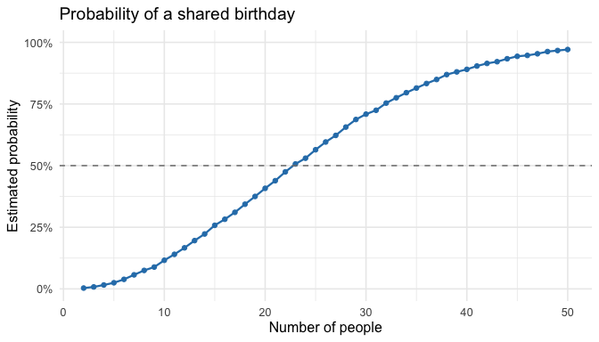
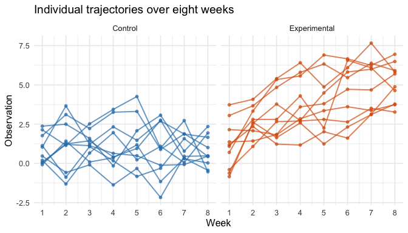
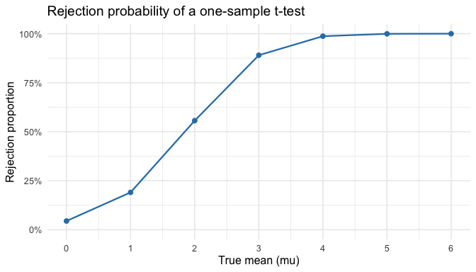
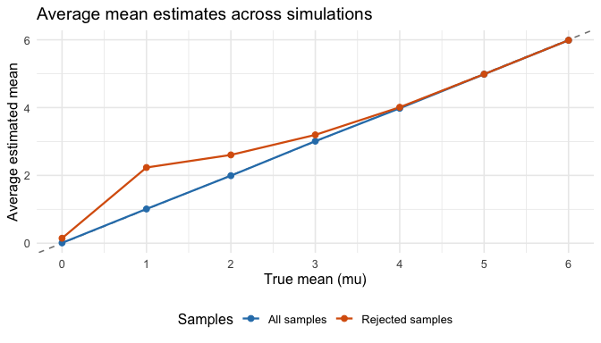

P8105 Homework 5
================
Ziyang Tian (zt2426)

# Problem 1

``` r
birthday_match <- function(n_people) {
  birthdays <- sample(1:365, size = n_people, replace = TRUE)
  
  any(duplicated(birthdays))
}
```

``` r
set.seed(123)

birthday_results <- tibble(
  group_size = 2:50
) %>%
  mutate(
    probability = map_dbl(
      group_size,
      function(n_people) {
        mean(replicate(10000, birthday_match(n_people)))
      }
    )
  )

birthday_results %>%
  filter(group_size %in% c(2, 23, 50)) %>%
  knitr::kable(digits = 3)
```

| group_size | probability |
|-----------:|------------:|
|          2 |       0.003 |
|         23 |       0.507 |
|         50 |       0.971 |

``` r
ggplot(birthday_results, aes(x = group_size, y = probability)) +
  geom_line(color = "#2C7FB8", linewidth = 0.8) +
  geom_point(color = "#2C7FB8", size = 1.5) +
  geom_hline(
    yintercept = 0.5,
    linetype = "dashed",
    color = "grey50"
  ) +
  scale_y_continuous(
    labels = scales::label_percent(),
    limits = c(0, 1)
  ) +
  labs(
    title = "Probability of a shared birthday",
    x = "Number of people",
    y = "Estimated probability"
  ) +
  theme_minimal(base_size = 12)
```

<!-- -->

The estimated probability of at least two people sharing a birthday
increases as the group size increases. It is about 51% for a group of 23
people and about 97% for a group of 50 people. Larger groups contain
more pairs of people, which creates more opportunities for a shared
birthday.

# Problem 2

``` r
participant_files <- tibble(
  file_name = list.files("data", pattern = "\\.csv$")
) %>%
  mutate(
    data = map(
      file_name,
      function(current_file) {
        read_csv(
          file.path("data", current_file),
          show_col_types = FALSE
        )
      }
    )
  )

participant_files
```

    ## # A tibble: 20 × 2
    ##    file_name  data              
    ##    <chr>      <list>            
    ##  1 con_01.csv <spc_tbl_ [1 × 8]>
    ##  2 con_02.csv <spc_tbl_ [1 × 8]>
    ##  3 con_03.csv <spc_tbl_ [1 × 8]>
    ##  4 con_04.csv <spc_tbl_ [1 × 8]>
    ##  5 con_05.csv <spc_tbl_ [1 × 8]>
    ##  6 con_06.csv <spc_tbl_ [1 × 8]>
    ##  7 con_07.csv <spc_tbl_ [1 × 8]>
    ##  8 con_08.csv <spc_tbl_ [1 × 8]>
    ##  9 con_09.csv <spc_tbl_ [1 × 8]>
    ## 10 con_10.csv <spc_tbl_ [1 × 8]>
    ## 11 exp_01.csv <spc_tbl_ [1 × 8]>
    ## 12 exp_02.csv <spc_tbl_ [1 × 8]>
    ## 13 exp_03.csv <spc_tbl_ [1 × 8]>
    ## 14 exp_04.csv <spc_tbl_ [1 × 8]>
    ## 15 exp_05.csv <spc_tbl_ [1 × 8]>
    ## 16 exp_06.csv <spc_tbl_ [1 × 8]>
    ## 17 exp_07.csv <spc_tbl_ [1 × 8]>
    ## 18 exp_08.csv <spc_tbl_ [1 × 8]>
    ## 19 exp_09.csv <spc_tbl_ [1 × 8]>
    ## 20 exp_10.csv <spc_tbl_ [1 × 8]>

``` r
study_tidy <- participant_files %>%
  mutate(
    participant_id = str_remove(file_name, "\\.csv$")
  ) %>%
  separate(
    participant_id,
    into = c("arm", "subject_id"),
    sep = "_",
    remove = FALSE
  ) %>%
  mutate(
    arm = recode(
      arm,
      con = "Control",
      exp = "Experimental"
    )
  ) %>%
  unnest(cols = data) %>%
  pivot_longer(
    cols = starts_with("week_"),
    names_to = "week",
    names_prefix = "week_",
    names_transform = list(week = as.integer),
    values_to = "observation"
  ) %>%
  select(participant_id, arm, subject_id, week, observation)

study_tidy %>%
  slice_head(n = 8) %>%
  knitr::kable(digits = 2)
```

| participant_id | arm     | subject_id | week | observation |
|:---------------|:--------|:-----------|-----:|------------:|
| con_01         | Control | 01         |    1 |        0.20 |
| con_01         | Control | 01         |    2 |       -1.31 |
| con_01         | Control | 01         |    3 |        0.66 |
| con_01         | Control | 01         |    4 |        1.96 |
| con_01         | Control | 01         |    5 |        0.23 |
| con_01         | Control | 01         |    6 |        1.09 |
| con_01         | Control | 01         |    7 |        0.05 |
| con_01         | Control | 01         |    8 |        1.94 |

``` r
ggplot(
  study_tidy,
  aes(
    x = week,
    y = observation,
    group = participant_id,
    color = arm
  )
) +
  geom_line(alpha = 0.7, linewidth = 0.7) +
  geom_point(alpha = 0.7, size = 1.3) +
  facet_wrap(~ arm) +
  scale_x_continuous(breaks = 1:8) +
  scale_color_manual(
    values = c(
      "Control" = "#2C7FB8",
      "Experimental" = "#D95F0E"
    )
  ) +
  labs(
    title = "Individual trajectories over eight weeks",
    x = "Week",
    y = "Observation"
  ) +
  theme_minimal(base_size = 12) +
  theme(legend.position = "none")
```

<!-- -->

Each line represents one participant’s observations over eight weeks.
The control group shows fluctuations over time without a clear overall
upward trend. In the experimental group, observations generally increase
over time and are higher than those in the control group during the
later weeks. Both groups show differences between participants and
week-to-week variation.

# Problem 3

``` r
simulate_t_test <- function(true_mu) {
  simulated_data <- rnorm(
    n = 30,
    mean = true_mu,
    sd = 5
  )
  
  t.test(
    simulated_data,
    mu = 0,
    alternative = "two.sided"
  ) %>%
    broom::tidy() %>%
    select(estimate, p.value)
}
```

``` r
set.seed(123)

simulation_results <- expand_grid(
  true_mu = 0:6,
  iteration = 1:5000
) %>%
  mutate(
    results = map(true_mu, simulate_t_test)
  ) %>%
  unnest(cols = results) %>%
  mutate(
    reject_null = p.value < 0.05
  )
```

``` r
power_summary <- simulation_results %>%
  group_by(true_mu) %>%
  summarise(
    rejection_rate = mean(reject_null),
    .groups = "drop"
  )

estimate_summary <- simulation_results %>%
  group_by(true_mu) %>%
  summarise(
    all_samples = mean(estimate),
    rejected_samples = mean(estimate[reject_null]),
    .groups = "drop"
  )

knitr::kable(power_summary, digits = 3)
```

| true_mu | rejection_rate |
|--------:|---------------:|
|       0 |          0.045 |
|       1 |          0.191 |
|       2 |          0.556 |
|       3 |          0.890 |
|       4 |          0.987 |
|       5 |          0.999 |
|       6 |          1.000 |

``` r
knitr::kable(estimate_summary, digits = 3)
```

| true_mu | all_samples | rejected_samples |
|--------:|------------:|-----------------:|
|       0 |       0.009 |            0.147 |
|       1 |       1.010 |            2.233 |
|       2 |       1.992 |            2.604 |
|       3 |       3.010 |            3.195 |
|       4 |       3.979 |            4.010 |
|       5 |       4.984 |            4.986 |
|       6 |       5.986 |            5.986 |

``` r
ggplot(
  power_summary,
  aes(x = true_mu, y = rejection_rate)
) +
  geom_line(color = "#2C7FB8", linewidth = 0.8) +
  geom_point(color = "#2C7FB8", size = 2) +
  scale_x_continuous(breaks = 0:6) +
  scale_y_continuous(
    labels = scales::label_percent(),
    limits = c(0, 1)
  ) +
  labs(
    title = "Rejection probability of a one-sample t-test",
    x = "True mean (mu)",
    y = "Rejection proportion"
  ) +
  theme_minimal(base_size = 12)
```

<!-- -->

When the true mean is zero, the rejection rate is about 4.5%, which is
close to the nominal significance level of 5%. For positive true means,
power increases as the true mean moves farther from zero. With the
sample size and standard deviation held fixed, larger effects are easier
to detect. Power is close to 100% when the true mean is 5 or 6.

``` r
estimate_plot_data <- estimate_summary %>%
  pivot_longer(
    cols = c(all_samples, rejected_samples),
    names_to = "sample_type",
    values_to = "mean_estimate"
  ) %>%
  mutate(
    sample_type = recode(
      sample_type,
      all_samples = "All samples",
      rejected_samples = "Rejected samples"
    )
  )

ggplot(
  estimate_plot_data,
  aes(
    x = true_mu,
    y = mean_estimate,
    color = sample_type
  )
) +
  geom_abline(
    intercept = 0,
    slope = 1,
    linetype = "dashed",
    color = "grey50"
  ) +
  geom_line(linewidth = 0.8) +
  geom_point(size = 2) +
  scale_x_continuous(breaks = 0:6) +
  scale_color_manual(
    values = c(
      "All samples" = "#2C7FB8",
      "Rejected samples" = "#D95F0E"
    )
  ) +
  labs(
    title = "Average mean estimates across simulations",
    x = "True mean (mu)",
    y = "Average estimated mean",
    color = "Samples"
  ) +
  theme_minimal(base_size = 12) +
  theme(legend.position = "bottom")
```

<!-- -->

The average estimated mean across all samples is close to the true mean.
However, when only samples that reject the null hypothesis are included,
the average estimate is too high for small positive true means,
especially 1 and 2. Samples with larger estimated effects are more
likely to produce significant results, so selecting only significant
results creates selection bias.

As the true mean increases, almost all samples reject the null
hypothesis, and the two averages become similar. At a true mean of zero,
significant estimates can be either positive or negative. Their average
is centered at zero in theory, although it can differ from zero in a
finite simulation.
